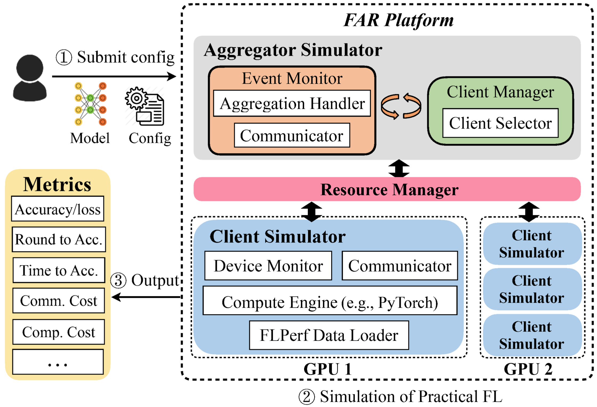

<div class="row">
  <div class="column">
    
  </div>
  <div class="column">
    
  </div>
</div>

## REFL: Aprendizaje Federado Eficiente en Recursos ([Paper](https://arxiv.org/abs/2111.01108))

Este repositorio contiene scripts e instrucciones para ejecutar REFL, un marco de trabajo de aprendizaje federado eficiente en recursos. 
REFL aborda sistemáticamente la cuestión de la eficiencia de recursos en el aprendizaje federado (FL), mostrando los beneficios de la selección inteligente de participantes y la incorporación de actualizaciones de participantes lentos (stragglers). 


REFL es una extensión de [FedScale](http://fedscale.ai), que proporciona un conjunto diverso de conjuntos de datos y benchmarks para el entrenamiento y la evaluación de FL. 
Los conjuntos de datos son a gran escala, abarcando una amplia gama de tareas importantes de FL, como la clasificación de imágenes, detección de objetos, modelado del lenguaje, reconocimiento de voz y aprendizaje por refuerzo. 


***REFL será de código abierto con licencias permisivas y damos la bienvenida a los comentarios y contribuciones de la comunidad!***

## Resumen

* [Primeros Pasos](#getting-started)
* [Configurar Clúster GPU](#setting-gpu-cluster)
* [Conjuntos de Datos Realistas de FL](#realistic-fl-datasets)
* [Ejecutar experimentos de REFL](#running-refl-experiments)
* [Detener los experimentos](#stopping-the-experiments)
* [Estructura del Repositorio](#repo-structure)
* [Nota](#acknowledgements)
* [Contacto](#contact)

## Primeros Pasos 

Nuestro script ```install.sh``` instalará lo siguiente automáticamente:

* Gestor de paquetes Anaconda
* CUDA 10.2

Nota: si prefieres versiones diferentes de conda y CUDA, consulta los comentarios en `install.sh` para más detalles.

Ejecuta los siguientes comandos para instalar el entorno conda de REFL. 

```
git clone https://github.com/ahmedcs/REFL
cd REFL
source install.sh 
```

Ejecuta los siguientes comandos para instalar Oort. 

```
cd REFL/thirdparty
python oort_setup.py install
```

### Configurar Clúster GPU

***Asegúrate de que estas rutas sean consistentes en todos los nodos para que el simulador pueda encontrar la ruta correcta.***

- ***Nodo Maestro***: Asegúrate de que el nodo maestro (servidor de parámetros) tenga acceso a otros nodos trabajadores mediante ```ssh``. 

- ***Todos los Nodos***: Sigue [estos pasos](#getting-started) para instalar todas las bibliotecas necesarias y luego descarga los conjuntos de datos siguiendo [este enlace](dataset/README.md).


## Conjuntos de Datos Realistas de FL

***A continuación se muestran los conjuntos de datos utilizados en el artículo; debes descargar el conjunto de datos antes de ejecutar los experimentos.***

Tareas de Visión por Computador (CV):

| Conjunto de Datos   | Tipo de Datos   | # de Clientes | # de Muestras | Tarea de Ejemplo | 
|-----------| ----------- |--------------|--------------|    ----------- |
| CIFAR10   |   Imagen     | Personalizado       | 60K          |   Clasificación  |    
| OpenImage |   Imagen     | 13,771       | 1.3M         |   Clasificación, Detección de objetos      |

Tareas de PLN (NLP):

| Conjunto de Datos       | Tipo de Datos   |# de Clientes  | # de Muestras   | Tarea de Ejemplo | 
| -----------   | ----------- | -----------  |  ----------- |   ----------- |
| Stackoverflow |   Texto      |   342,477    |   135M        |  Predicción de palabras, clasificación |
| Reddit        |   Texto      |  1,660,820   |   351M        |  Predicción de palabras   |
|Google Speech  |   Audio     |     2,618    |   105K        |   Reconocimiento de voz |


***Tenga en cuenta que no se conservaron detalles sobre la edad, el género o la ubicación de ningún participante, y se asignaron identificadores aleatorios a cada individuo. Al utilizar estos conjuntos de datos, obedeceremos estrictamente sus licencias, y estos conjuntos de datos proporcionados en este repositorio deben utilizarse únicamente con fines de investigación.***

Por favor, ve al directorio `./dataset` y sigue el [README](dataset/README.md) del conjunto de datos para obtener más detalles sobre cómo configurar estos conjuntos de datos.


## Ejecutar experimentos de REFL
REFL utiliza el Runtime Automatizado de FedScale (FAR), que es una plataforma de evaluación automatizada y de fácil implementación, para simplificar y estandarizar la configuración experimental de FL y la evaluación de modelos en un entorno práctico. FAR se basa en el [proyecto Oort](https://github.com/SymbioticLab/Oort).



Por favor, ve al directorio `./core` y sigue el archivo [README](core/README.md) para entender mejor cómo se invocan los scripts de entrenamiento de FL.

Para ejecutar los experimentos, proporcionamos un script personalizable que puede automatizar el lanzamiento de muchos experimentos a la vez. El archivo de script en el directorio principal `run_exps.sh` puede ajustarse según sea necesario para configurar los diversos parámetros que están documentados en el propio archivo.
El script toma como entrada el conjunto de datos (o benchmark) a ejecutar y ejecutará todos los experimentos, asignando a cada servidor un experimento a la vez en orden circular (round robin) hasta que todos los experimentos se lancen simultáneamente. 
Idealmente, necesitamos ejecutar un solo experimento en cada servidor, donde 1 GPU se utiliza como agregador y las restantes como ejecutores.

Los resultados experimentales se recopilan y cargan automáticamente a través de las APIs de la herramienta de visualización WANDB llamada [WANDB](wandb.ai). **Debes crear o tener una cuenta en [WANDB](wandb.ai) y, desde la página de configuración, obtener la Clave API y el nombre de usuario para configurarlos en los scripts de ejecución de experimentos como se muestra a continuación.**

En el script [run_exps.sh](run_exps.sh), la lista IPS se refiere a la lista de IPs de los servidores y la lista GPUS se refiere al número de GPUs por servidor. 
Los ajustes restantes que deben configurarse están bien comentados en el archivo del script, son:
```
#the path to the project
export MAIN_PATH=/home/user/REFL
# the path to the dataset, note $dataset, the dataset name passed as argument to script
export DATA_PATH=/home/user/REFL/dataset/data/$dataset
#the path to the conda envirnoment
export CONDA_ENV=/home/user/anaconda3/envs/refl
#the path to the conda source script
export CONDA_PATH=/home/user/anaconda3/

#Set WANDB for logging the experiments results or do wandb login from terminal
export WANDB_API_KEY=""
# The entity or team used for WANDB logging, should be set correctly, typically should be set your WANDB userID
export WANDB_ENTITY=""
```
Estas variables de entorno exportadas se pasan a los [archivos de configuración](core/evals/configs) de los experimentos como variables de entorno.

Lo siguiente es un ejemplo de invocación de experimento; por defecto, tenemos 4 servidores equipados cada uno con 4 GPUs configurados en el script `run_exps.sh`.

```
conda activate refl
bash run_exps.sh google_speech
```
Adicionalmente, proporcionamos una versión personalizada del script [run_exps.sh](run_exps.sh), que son [run_E1.sh](run_E1.sh) y [run_E2.sh](run_E2.sh) para ejecutar experimentos que comparan REFL vs Oort (los resultados de la Figura 9.b en el artículo) y REFL vs SAFA (los resultados en la Figura 10.b en el artículo), respectivamente.  
Ahora, para ejecutar el experimento E1, simplemente invoca la siguiente línea en el directorio principal. Asegúrate de iniciar sesión en WANDB o configurar WANDB_API_KEY en el archivo del script.
```
conda activate refl
bash run_E1.sh google_speech
```
**Ten en cuenta que cada experimento se lanza con su propia marca de tiempo y todos los registros y modelos intermedios se almacenan en una carpeta nombrada según dicha marca de tiempo.**

## Generar gráficos de los experimentos
Para graficar los resultados, proporcionamos un script personalizable que puede automatizar el proceso invocando las APIs de WANDB para obtener los datos y utilizando Matplotlib para el trazado real. 
El script se encuentra en el directorio plots y se llama [plot_exp.py](plots/plot_exp.py), el cual ayuda a graficar los resultados.
También proporcionamos todos los comandos utilizados para graficar todas las figuras del artículo, como se detalla en [plot_cmds](plots/plot_cmds.md); por ejemplo, para graficar los resultados de los experimentos de [run_E1](run_E1.sh), invoca el siguiente comando:
```
python plots/plot_exp.py 'exp_type' google_speech_resnet34 'oort' 'Test' 1 10
```

## Detener los experimentos
Para detener los experimentos antes de que se completen, proporcionamos un script personalizable que puede automatizar la terminación de ciertos experimentos de un benchmark en particular o de todos los benchmarks. El script toma como entrada el nombre del conjunto de datos (o benchmark) y la marca de tiempo generada automáticamente basada en la fecha y hora actuales.
Para terminar los experimentos de google_speech que se están ejecutando actualmente con la marca de tiempo 220722_12737
```
bash kill_exps.sh google_speech 220722_12737
```
Para terminar todos los experimentos de google_speech que se están ejecutando actualmente
```
bash kill_exps.sh google_speech
```
Para terminar todos los experimentos que se están ejecutando actualmente
```
bash kill_exps.sh all
```

## Estructura del Repositorio

```
Repo Root
|---- dataset     # Realistic datasets in REFL
|---- plots      # scripts and commands for plotting the results
|---- core        # Experiment platform of REFL containing aggregator, clients, executors and resource manager
    |---- utils   # Utiliy and helper modules such as dataloaders, decoder, data divider, models, etc
    |---- evals     # Backend of job submission
 
```

## Notas
Por favor, considera citar nuestros artículos si utilizas el código o los datos en tu proyecto de investigación.

```bibtex
@inproceedings{REFL-arxiv,
  title={Resource-Efficient Federated Learning},
  author={Ahmed M. Abdelmoniem, Atal Narayan Sahu, Marco Canini, Suhaib A. Fahmy},
  booktitle={arXiv:2111.01108},
  year={2021}
}
```

y  

```bibtex
@inproceedings{REFL-EuroSys23,
  title={REFL: Resource Efficient Federated Learning},
  author={Ahmed M. Abdelmoniem, Atal Narayan Sahu, Marco Canini, Suhaib A. Fahmy},
  booktitle={ACM EuroSys},
  year={2023}
}
```

## Contacto
Ahmed M. A. Sayed, también conocido como Ahmed M. Abdelmoniem (ahmedcs982@gmail.com).
